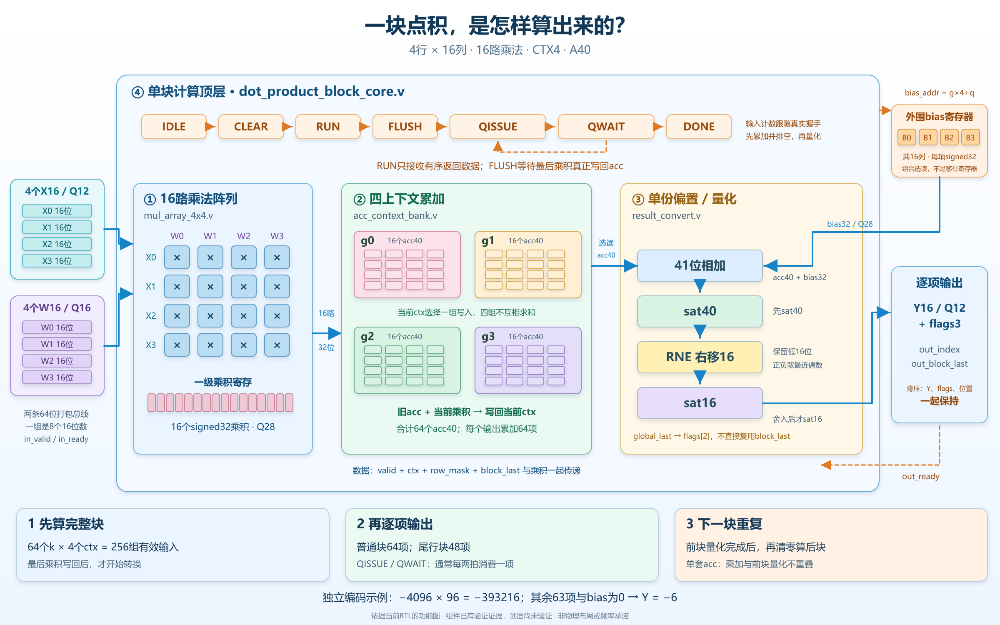
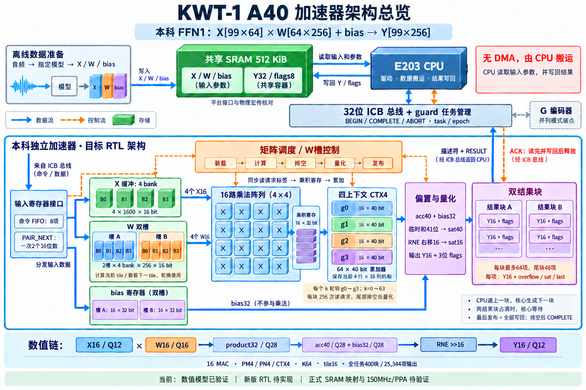

# 架构与点积模块图

## 当前四模块点积图（2026-10-28）

本图依据当前四个RTL模块绘制：外框是 `dot_product_block_core.v`，内部依次是 `mul_array_4x4.v`、`acc_context_bank.v`、`result_convert.v`。蓝色实线表示数据方向，橙色虚线表示控制或ready反馈。

- 4个X16与4个W16形成16个乘积，不是64位乘法。
- 四个ctx各有4×4个acc40，总共64个累加值，16路加法按ctx选择更新；不同ctx不互相相加。
- 固定k时轮转g0..g3，64个k共256组；最后乘积写回后再逐项量化，普通块64项、尾行块48项。
- 量化器只放一份：41位加bias、sat40、RNE右移16、sat16；顶层QISSUE/QWAIT下通常每两拍消费一项，背压会延长间隔。
- bias是外围组合选读接口，图中的寄存器条为来源示意，不表示顶层新增了一套bias存储。
- 单套acc使各块依次计算、再量化；不表示前块量化与后块乘加重叠。
- 图形为功能关系，不是精确物理布局；图生成后的当前顶层已通过[完整端口回归](../../verification/block-core-20261028T223900-96b70c/README.md)，外围与整机仍未实现/验证。

文件：

- [PNG结构图](kwt1-dot-product-block-core-vector.png)：当前推荐图，格数与文字按源码关系检查。
- [可编辑SVG](kwt1-dot-product-block-core.svg)：保留独立文字/图形对象，便于继续调整。
- [SVG生成源码](dot-product-block-core-vector-source.js)：Windows Node脚本，使用系统中文字体，无需联网即可重新绘制。
- [源码身份](dot-product-block-core-source-manifest.json)：记录对应的四模块及宏文件SHA256。
- [ImageGen提示词](dot-product-block-core-prompt.txt)、[生成/局部校正记录](dot-product-block-core-edit-prompts.txt)。

内置ImageGen首次网络请求失败，重试生成了参考插画v1；v1中ctx格子数画成了示意数量，局部校正请求等待较久后取消。因此当前推荐图改用原生SVG精确绘制，并导出PNG，没有使用CLI/API兜底。`kwt1-dot-product-block-core-v1.png`保留为插画草稿，不作为格数准确版。原来的整机架构图保留在下方。

## 整机架构总览（2026-10-27历史版本）

日期：2026-10-27。采用内置image_gen生成，经三次局部校对调整箭头、bias寄存器表示和量化模块连线。对应当前个人FFN1目标架构，非已完成RTL或网表图。

## 阅读方法

- 上方是系统环境：离线数据准备、共享SRAM、E203、ICB/guard；灰色G是并列模式端点，不是本科FFN1后级。
- 蓝色大框内是目标本科独立加速器；蓝线表示数据，橙色虚线表示调度、控制和ACK。
- 左侧输入接口分发X/W/bias；X四bank、W双槽供数；bias是两槽各16个32位寄存器，不是SRAM四bank。
- 中间16路乘法器共用四上下文，每个上下文保存16个40位累加值，合计64个；没有64路乘法器。
- 右侧先加bias，再以41位临时和处理sat40，RNE右移16后sat16；双结果块保存Y16及三个标志。
- CPU读取结果，写回共享Y32/flags8后ACK释放结果块。图中不存在加速器直接向共享RAM发起DMA。
- 此旧图生成时仅数值模型已验证；当前组件及单块顶层进度见 [实现进度](../implementation/progress.md)。正式共享接口、物理宏、150MHz及PPA仍待核对和验证。

图标和箭头表达功能关系，不是精确端口图、物理布局或周期波形。细节以 [架构规格](../architecture/README.md) 为准。

## 生成记录

初始完整提示词保存在 [architecture-overview-prompt.txt](architecture-overview-prompt.txt)，局部校对提示词保存在 [architecture-edit-prompts.txt](architecture-edit-prompts.txt)。未修改任何RTL、数值模型或原交接包。
