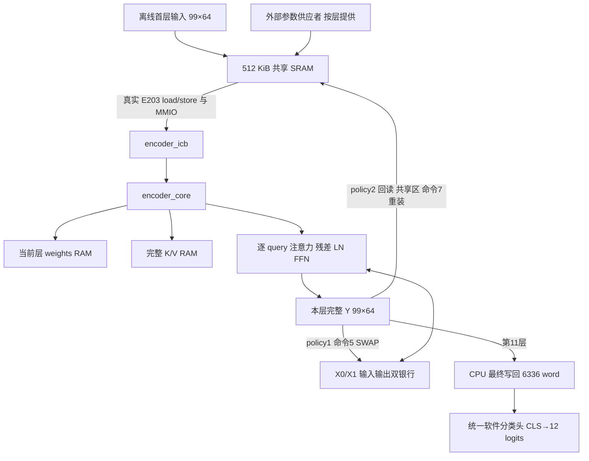

# 十二层编码器与参数调度

十二层编码器的关键是让同一计算核心连续处理全部 12 层，并在 512 KiB 共享 SRAM 的限制下及时更换参数。当前实现已经留下真实 E203 执行完整十二层、两种层间交接策略输出逐位一致的本地证据；内部交换相对外部重载减少 6,273,949 个端到端周期。这个结论适用于本文记录的冻结实现和同一输入，不代表正式比赛平台、600 样本精度或指定工艺的验收结论。

## 1. 赛题任务、输入输出与完成边界

### 1.1 为什么必须逐层调度

《2026 赛题指南》任务 6 要求顺序执行全部十二层编码器，完成层间数据传递、逐层参数更新和统一软件分类头验证。E203 负责命令与搬运，编码器内数值运算由加速器执行。本科必做为任务 1—3；本篇对应已经批准开展的选做任务 6。条款位于 PDF 物理页 9／印刷页 8，参数装载和存储约束位于物理页 4／印刷页 3，模型边界位于物理页 6—7／印刷页 5—6；可核对[赛题 PDF 工程副本](../../../work/report_cycle_sources/2026赛题指南.pdf)与[逐页文本](../../../work/report_cycle_sources/guide-text.txt)。

全十二层打包参数共有 597,504 个 FP32 word，即 2,390,016 B。共享 SRAM 只有 524,288 B，因此不能把十二层参数同时放入共享区。当前方案每次只提供一层参数，CPU 将其搬入加速器，再在该层完成后请求下一层。外部供参不承担注意力、LayerNorm 或前馈网络运算，也没有增加 DDR 控制器。

| 对象 | 形状／数量 | 格式与含义 | 是否进入硬件任务 |
|---|---|---|---|
| 原始音频与 MFCC | 1 s、16 kHz 单声道；98×40 MFCC | 官方流程离线生成 | 否 |
| 首层输入 $X^{(0)}$ | 99×64＝6,336 word | FP32；包含 CLS、输入投影和位置编码 | 是 |
| 一层参数 θℓ | 49,792 word＝199,168 B | 13 段矩阵／向量，行主序 | 是，逐层更新 |
| 十二层参数 | 12×49,792＝597,504 word | 层号 0…11，内容各不相同 | 是，分时供给 |
| 中间／最终激活 | 每层 99×64 | 下一层必须接收上一层完整输出 | 是 |
| 最终分类输入 | 最终激活第 0 行，64 维 CLS | 与官方相同的线性分类头 | 软件评测；不计硬件吞吐 |
| 分类输出 | 12 logits 与 Top-1 标签 | labels 顺序见参考 manifest | 软件评测 |

单次 batch＝1，固定序列长度 99、特征维数 64、单头注意力、FFN 维数 64→256→64；不增加变长输入或因果掩码。使用指定 `237e4097` 版本 KWT-1 预训练权重，推理关闭 Dropout，不重新训练、微调、蒸馏或改变模型基本结构。

### 1.2 全十二层到底计算什么

每一层都执行以下 PostNorm 链路，全部 99 个 token 都参与，不能只计算 CLS：

$$
X^{(\ell+1)}=\operatorname{LN}_{2,\ell}\left(N_\ell+
\operatorname{GELU}(N_\ell W_{1,\ell}+b_{1,\ell})W_{2,\ell}+b_{2,\ell}\right),
$$

$$
N_\ell=\operatorname{LN}_{1,\ell}\left(X^{(\ell)}+
\operatorname{Softmax}\left(\frac{(X^{(\ell)}W_{q,\ell})(X^{(\ell)}W_{k,\ell})^T}{8}\right)
(X^{(\ell)}W_{v,\ell})W_{o,\ell}+b_{o,\ell}\right),\quad \ell=0,\ldots,11.
$$

这里每一层有自己独立的权重、偏置和两组 LayerNorm gamma/beta；循环复用的是硬件资源，不是把第 0 层参数重复十二次。Q/K/V 无偏置，输出投影有偏置；两处 LayerNorm 均沿每个 token 的 64 维进行，epsilon＝$10^{-6}$。当前 GELU 使用冻结的 tanh 近似，官方参考为 erf 形式；二者的误差与 RTL 位真一致性分开验证。

## 2. 完整数据流与模块分工

文字流程：离线输入 → 共享 SRAM 输入区 → E203 搬入 X bank → host 按请求覆盖一层参数区 → E203 搬入 weights RAM → 加速器完整单层计算 → 内部 SWAP 或 CPU 回读并 RELOAD → 重复至第 11 层 → CPU 写回完整 99×64 输出 → 同一软件分类头 → 数值与分类核对。



| 模块／文件 | 负责的工作 | 关键数据与控制边界 |
|---|---|---|
| [生产固件](../../../sw/e203_encoder/main.c) | 检查原 FFN1 ID、初始化、请求各层参数、调用驱动 | 十二层循环 `l=0; l<12; l++`；没有神经网络算术 |
| [驱动](../../../sw/encoder_driver.c)与[接口声明](../../../sw/encoder_driver.h) | 校验几何、顺序装载、START、等待、读回、换层 | 所有输入／参数经公开 MMIO 接口进入 core |
| [SoC 顶层](../../../soc/e203_encoder/e203_encoder_soc.sv) | 连接真实 E203、共享 RAM、原 FFN1 和新 encoder | 一次在途外设事务，保留原窗口 |
| [ICB 桥](../../../rtl/encoder_icb.sv) | 寄存器映射、握手、状态、sticky error、完成等待 | 请求与响应分离，响应未消费时保持 |
| [编码器核心](../../../rtl/encoder_core.sv) | K/V 全序列生成、逐 query 完整单层运算、银行切换 | `x_count`、`w_count`、`layer_index` 限制合法启动 |
| [FP32 单元](../../../rtl/encoder_fp32.sv)、[非线性单元](../../../rtl/encoder_nonlinear.sv) | FMA/ADD/MUL/DIV/SQRT 与 exp/GELU | 共享标量多周期运算，冻结舍入和运算顺序 |
| [同步 RAM](../../../rtl/encoder_sync_ram.sv) | 参数、X0/X1、K/V | 同步读取；控制状态保证数据有效，不整体复位存储阵列 |
| [系统测试台](../../../dv/e203_encoder/tb_e203_encoder.sv) | 装固件、公开共享区供参、被动核对输出、实际握手计数 | 不写 encoder 内部数组，不计算或注入神经输出 |
| [独立 C 数值参考](../../../numeric/encoder/encoder_ref.c) | 生成每层全量期望输出与软件分类结果 | 同格式、同顺序；用于比较，不代替 RTL 执行 |

核心先算完整 K/V，再逐 query 计算 Q、99 项分数、Softmax 和 context，随后完成该行的两次残差、两次 LayerNorm 与 FFN。这样复用一个 FP32 单元和行级暂存，不需要常驻完整 99×99 分数矩阵。代价是计算串行，周期较多；本批未扩大并行度或改变位宽。

这一选择先建立全部算子的逐操作可核验闭环。全定点可以降低部分存储与算术成本，但十二层 Softmax、LayerNorm 与 GELU 的尺度、饱和和误差传播需要额外验证；直接采用大并行阵列则会增加多端口供数、银行冲突和调试复杂度。本批不采用这两条扩展路线，优先检验不改变算术的层间复用。选择理由及固定数值顺序见[冻结设计](../../../work/formal_seven_design.md)，不能据此推定当前标量实现满足工艺预算。

## 3. 参数格式与内存布局

### 3.1 一层参数的唯一打包顺序

参数偏移以 32 位 word 计，实际字节偏移乘 4。矩阵以行主序展平；例如 $W_1[k,j]$ 的 word 地址为 `16576+k*256+j`。这一顺序由导出、独立 C 参考、RTL 和驱动共同遵守，完整清单位于[reference manifest](../../../reports/encoder/reference/manifest.json)的 `weight_layout`。

| 段 | 形状 | 起始 word | word 数 | 在计算中的作用 |
|---|---|---:|---:|---|
| Wq | 64×64 | 0 | 4,096 | query 投影 |
| Wk | 64×64 | 4,096 | 4,096 | key 投影 |
| Wv | 64×64 | 8,192 | 4,096 | value 投影 |
| Wo | 64×64 | 12,288 | 4,096 | 注意力输出投影 |
| bo | 64 | 16,384 | 64 | 输出投影偏置 |
| LN1 gamma | 64 | 16,448 | 64 | 第一处归一化缩放 |
| LN1 beta | 64 | 16,512 | 64 | 第一处归一化平移 |
| W1 | 64×256 | 16,576 | 16,384 | FFN 第一线性层 |
| b1 | 256 | 32,960 | 256 | FFN 第一层偏置 |
| W2 | 256×64 | 33,216 | 16,384 | FFN 第二线性层 |
| b2 | 64 | 49,600 | 64 | FFN 第二层偏置 |
| LN2 gamma | 64 | 49,664 | 64 | 第二处归一化缩放 |
| LN2 beta | 64 | 49,728 | 64 | 第二处归一化平移 |
| 合计 | — | — | **49,792** | **199,168 B／层** |

$$
W_{\rm layer}=4D^2+2DH+H+6D
=4\times64^2+2\times64\times256+256+6\times64=49,792.
$$

`6D` 是 bo、LN1 gamma、LN1 beta、b2、LN2 gamma、LN2 beta，另一个 H 维向量是 b1。层文件分别为 `layer_00.hex` 至 `layer_11.hex`，每个文件有自己的内容与哈希。正式推理中不把层参数容量乘十二后要求其同时驻留共享 SRAM。

### 3.2 共享 SRAM 的实际地址

[共享 RAM](../../../soc/e203_encoder/encoder_shared_ram.sv)基址为 `0xA0000000`，容量为 131,072×32 bit＝512 KiB。下表端点均为左闭右开，方便检查区域不相交。

| 区域 | 地址范围 | 有效容量 | 实际使用者 |
|---|---|---:|---|
| 邮箱及层周期记录 | `0xA0000000` 起；TB 初始化前 64 word | 本地约定保留 256 B | CPU 与 host |
| 首层输入 | `[0xA0001000,0xA0007300)` | 25,344 B | TB 初始预置，CPU 读取 |
| 当前层参数 | `[0xA0008000,0xA0038A00)` | 199,168 B | host 覆盖，CPU 读取 |
| CPU 输出暂存 | `[0xA0040000,0xA0046300)` | 25,344 B | CPU 写回；reload 时再读取 |
| 总地址空间 | `[0xA0000000,0xA0080000)` | 524,288 B | 共享存储 |

这三个张量区互不重叠。参数区复用十二次，不需要十二份地址。初始输入、当前参数和输出的有效字节合计 249,856 B；地址洞与邮箱等另计，不能把这项有效载荷等同于整个 SRAM 的使用面积。

加速器内部还有独立的 weights、X0、X1、K、V 存储：49,792＋4×6,336＝75,136 word，即 300,544 B；行级 q、context、tmp、n1、score、prob、hidden 另有 710 word。内部存储不占用那 512 KiB 共享地址空间，其宏面积需要计入新增加速器预算。

## 4. 真实 CPU 调度、状态与故障出口

### 4.1 从 main 到每一层的握手

`main.c` 使用 volatile MMIO 和 `fence` 保证访问顺序。真实执行流程如下：

1. 读取原 FFN1 窗口 `0x11000000`，要求 ID 为 `0x4B575431`，验证两个加速器窗口同时存在。
2. `encoder_begin()` 检查 encoder ID `0x454E4331`、几何 `(99<<16)|64`、H＝256 和每层 49,792 word；发送 BEGIN＝0、清错误、将 6,336 word 输入搬到 encoder。
3. 每层先把 `mail[9]` 置为无效值，在 `mail[8]` 写层号，随后向 `mail[10]` 写 `0x4C4F4144` 请求供参。
4. TB host 读取真实请求层号，只写公开共享参数区；每个 word 消耗一个仿真周期，全部 49,792 word 写完后，才在 `mail[9]` 发布 ready 层号。固件有 10,000,000 次等待上限。
5. `encoder_layer_mode()` 要求设备层号等于当前 l，将 49,792 word 搬入 WEIGHT 数据口，读取 `W_COUNT` 确认完整，然后发送 START＝3。
6. 读取 `WAIT_DONE`；ICB 桥在运算完成前阻塞响应，带 40,000,000 周期 watchdog。其后驱动检查 STATUS 的错误、完成和忙位；第 11 层还检查 `job_done`。
7. 按策略读回、SWAP 或 RELOAD，固件在邮箱记录各层 `rdcycle` 差及完成层数。十二层全部成功后返回 0。

CPU 的循环只做整数索引、状态判断、load/store 与计时；FMA、Softmax、GELU、LayerNorm 在 RTL。TB 的 `expected.hex` 只被监视器用于比较，不能作为计算结果的数据源。

| 寄存器偏移 | 名称 | 读写与解释 |
|---:|---|---|
| `0x00` | ID | 只读 `0x454E4331` |
| `0x04` | STATUS | bit0 busy、bit1 done、bit2 job_done、bit3 error |
| `0x08` | COMMAND | 0 BEGIN；3 START；5 SWAP；7 RELOAD；6 为独立注意力测试入口 |
| `0x0C` | ERROR | sticky 原因；写低三位清除对应状态 |
| `0x10` | ADDR | word 索引；数据口合法完成后自动递增 |
| `0x14/0x18/0x1C` | INPUT／WEIGHT／OUTPUT | 输入写、参数写、输出读 |
| `0x20/0x24/0x28` | LAYER／X_COUNT／W_COUNT | 层号与有效装载量 |
| `0x2C/0x30/0x34` | CYCLES 低／高／FLAGS | core busy 计数与 FP 异常标志 |
| `0x38/0x3C/0x40` | GEOMETRY／H／WORDS | 驱动启动前核对形状 |
| `0x44` | WAIT_DONE | 完成等待；响应等待不等于命令端背压 |

忙时配置、装载与计算命令被拒绝；ERROR的W1C写及STATUS、计数读按各寄存器定义仍可使用。非法地址／对齐／掩码、未装满数据、错层号或非法换层不能成功。驱动区分参数错、I/O 错、设备状态错、超时和顺序错；看到 timeout 或 `rsp_error` 后应停止消费输出，并首先核对装载计数、状态和上一条命令。寄存器的完整行为以 [ICB RTL](../../../rtl/encoder_icb.sv)为准。

### 4.2 SWAP 和 RELOAD 为什么数值等价

policy1 的 SWAP＝5 在本层 done 后翻转 `x_bank`，层号加一、清空参数计数，但保留完整输入有效量；上一层 Y 所在的银行成为下一层 X。CPU 只在最后一层读取输出，因此中间十一层没有共享区往返。

policy2 的 RELOAD＝7 不翻转银行，层号加一，并把 `x_count`、`w_count` 清零。CPU 先把本层全部 Y 回读到共享输出区，再把这 6,336 word 逐个写回 INPUT 数据口，作为下一层 X。第 11 层之后只最终读回，不再重装。

两者不修改本层算子、FP32 格式、权重、FMA 顺序或非线性常数。policy0 是诊断用的“每层回读后内部交换”，不纳入本次性能二选一。

## 5. 已批准对照实验与实际收益

### 5.1 实验三要素与固定条件

[MASTER_RELEASE](../../../work/MASTER_RELEASE_encoder_reuse.md)只放行“外部回读重装／内部双银行交换”这个决策变量；目标分别是减少端到端周期与共享 SRAM 事务，不合成未定义的加权指标。约束为同模型、同输入、同数值顺序、同 CPU／总线／工具条件、512 KiB 共享 SRAM，以及各层完整输出逐位一致。本篇只回收这一实验，没有运行新的位宽、并行度、流水线或参数搜索。

两条真实 CPU 任务的输入均为 `eight_750e3e75_nohash_0`，输入 hex SHA-256 为 `e9782df2afe3870050d410ed8cee38d6d4c7c67533a36232edba088a2a3186f0`。两次模拟器 binary SHA 相同，固件以编译宏 `ENCODER_POLICY=1/2` 区分；两份固件镜像均为 1,512 B，状态记录均 PASS／exit_code＝0。

| 检查项 | 内部交换 policy1 | 外部重载 policy2 |
|---|---:|---:|
| 完整计算层数／被动 neural 核对 word | 12／76,032 | 12／76,032 |
| CPU 真实写回核对 word | 6,336，最终层 | 76,032，十二层 |
| 与独立 C 参考的位差／非有限 word | 0／0 | 0／0 |
| CPU 向 INPUT 写 word | 6,336 | 76,032 |
| CPU 向 WEIGHT 写 word | 597,504 | 597,504 |
| host 提供参数 word | 597,504 | 597,504 |
| neural 全十二层输出 SHA | `ae7f60af…198fea` | `ae7f60af…198fea` |

详细产物、固件、命令和来源映射分别见[内部交换 status](../../../reports/encoder/system/pingpong/status.json)、[外部重载 status](../../../reports/encoder/system/reload/status.json)。[独立 CPU 证据回读](../../../reports/system/review/encoder-final-cpu-readback.md)自行解析并比较了合计 152,064 个 neural word 和 82,368 个 CPU 写回 word，未发现位差或非有限值；它对运行消费物的回读不冒充运行前 staging 快照。

### 5.2 周期与共享流量同时下降

以下数字来自[实际性能 JSON](../../../reports/encoder/verification/performance.json)与两份原始 CPU status，百分比分母均为同一行的 reload 基准。

| 指标 | pingpong | reload | reload−pingpong | 相对 reload 的减少 |
|---|---:|---:|---:|---:|
| 端到端周期 | 284,353,480 | 290,627,429 | 6,273,949 | 2.1587601% |
| CPU 共享读事务 | 653,640 | 723,336 | 69,696 | 9.6353562% |
| CPU 共享写事务 | 6,394 | 76,090 | 69,696 | 91.5967933% |
| CPU 共享事务合计 | 660,034 | 799,426 | 139,392 | 17.4365107% |
| CPU 32 位 word 事务折算字节 | 2,640,136 | 3,197,704 | 557,568 | 17.4365107% |
| host 参数写／ready 写／请求读 | 597,504／12／12 | 597,504／12／12 | 0 | 0% |
| CPU＋供参 host 逻辑事务 | 1,257,562 | 1,396,954 | 139,392 | 9.9782813% |
| CPU＋供参 host 逻辑字节 | 5,030,248 | 5,587,816 | 557,568 | 9.9782813% |

省掉的是十一条层间边界，每条边界 6,336 word 的回读及重装：

$$
\Delta R=\Delta W=11\times6,336=69,696,\qquad
\Delta T=2\times69,696=139,392.
$$

这条形状计算解释了实际计数差的来源，不能替代监视器握手测量。host 的 597,504 次参数写、12 次 ready 写和 12 次请求读取没有减少，所以把 host 纳入分母后收益由 17.44% 降至 9.98%。计算本身占据较多周期，故周期收益只有 2.16%；不能从流量减少比例直接推出同幅度的加速或能耗减少。

## 6. 数值、分类与覆盖证据

### 6.1 两种比较回答不同问题

RTL 对本设计独立 C 参考要求逐 word 零差，回答“硬件是否实现冻结的数值规则”。本设计对官方浮点模型计算 NRMSE 和分类预测变化，回答“近似规则相对原模型改变了多少”。FP32 舍入、FMA 与分步操作顺序、exp 截断及 GELU 近似都会影响后者；不能因为使用 FP32 就宣称与 TensorFlow 原模型逐位相同。

$$
\operatorname{NRMSE}=\frac{\sqrt{\frac1n\sum_i(y_i-y_i^{\rm ref})^2}}
{\max\left(\sqrt{\frac1n\sum_i(y_i^{\rm ref})^2},10^{-8}\right)}.
$$

以下 NRMSE 是各工程输入最终 99×64 张量的比较摘要，不是官方 600 样本研究生分类门槛的替代品。

| 证据批次 | 输入数 | 完整层数 | 全量层输出 word | 最大最终 NRMSE | 与官方预测一致 |
|---|---:|---:|---:|---:|---:|
| 原参考三输入 | 3 | 36 | 228,096 | 0.0004071640493761876，约 0.0407164% | 3／3 |
| 公开 test 十二类工程子集 | 12 | 144 | 912,384 | 0.000513838042935309，约 0.0513838% | 12／12 |
| 合计 RTL 全层案例 | 15 | 180 | 1,140,480 | 按对应参考批次解释 | 不合并作总体准确率 |

当前冻结源的实际 RTL 逐层记录为[180 行 CSV](../../../reports/encoder/verification/rtl-layer-results.csv)，逐例为[15 行 CSV](../../../reports/encoder/verification/rtl-case-results.csv)。它们每层都验证 6,336 word；两条 CPU 实验各是其中同一个输入的一次真实十二层整机调度，不能把 12 个 RTL core 工程案例当作 12 个官方整机性能任务。

固定非线性验证还有 exp 的 100,001 点检查，最大相对误差 $7.082937654517834\times10^{-8}$；GELU 对精确 erf 的 40,001 点检查，最大绝对误差 0.00047341344033435817。范围和完整结果见[数值 manifest](../../../reports/encoder/reference/manifest.json)；这些检查不进行训练或拟合。

### 6.2 最终分类头的真实路径

最终输出取 $c=X^{(12)}[0,:]$，统一线性头计算 $z=cW_c+b_c$，其中 $W_c\in\mathbb{R}^{64\times12}$、$b_c\in\mathbb{R}^{12}$，再取 `argmax`。没有在编码器后额外插入 LayerNorm。官方导出用原分类头重放，[导出代码](../../../model/encoder_export.py)检查同图 logits 逐位一致；本设计参考用同一权重／标签顺序重放分类，见[参考入口](../../../numeric/encoder/run_reference.py)。

标签编号依次是 0 `_silence_`、1 `_unknown_`、2 yes、3 no、4 up、5 down、6 left、7 right、8 on、9 off、10 stop、11 go。原三输入包括两个真实 unknown 和一个合成全零静音；它与十二类工程子集中的 silence 输入不是同一个案例。

十二类工程子集的 `test_silence_f5468c2d20ff` 真实标签为 silence，但官方与本设计均预测 unknown；其他十一项与标签一致。因此“12／12 与官方预测一致”不能改写为“十二标签全正确”。各案例预测与误差见[test12 manifest](../../../reports/encoder/reference-test12/manifest.json)及[验证报告](../../../reports/encoder/verification/report.md)。正式要求仍是同一 600 样本、同一分类头下 Top-1 相对参考下降不超过 2 个百分点；本地工程子集不提供这个结论，也不得用于调整数值配置。

## 7. 复现入口、成功条件与失败诊断

### 7.1 先回读，再选择是否重跑

冻结清单为[192 项来源](../../../work/encoder_source_freeze.json)，清单 SHA-256 为 `4c11f4fa9c83592ee0e622e9c6a6ccf52a21eacef8d4a898e44aaf57cd27cc17`。CPU status 的来源、编译、输入、固件、binary、输出和日志哈希共同绑定运行；不能只看一个 PASS 字符串。

在项目根目录的 Linux／WSL 环境，以下只读命令核对现有冻结源：

```bash
.venv-dv/bin/python dv/encoder/freeze_sources.py --verify
```

成功信号是退出 0 且打印 `ENCODER_SOURCE_FREEZE_CURRENT files=192`。若提示来源或依赖在冻结后改变，应停止复用旧 PASS，由总控按影响面归档旧结果并重验；不要直接重写冻结文件来消掉错误。

以下是重建已有对照的入口，会编译并写结果，运行时间较长；本轮报告编写没有执行这些命令。应在现有统一验收结束后串行运行，避免覆盖正在使用的证据目录：

```bash
bash scripts/run_e203_encoder.sh --case eight_750e3e75_nohash_0 --policy 1 --output reports/encoder/system/reproduce-pingpong
bash scripts/run_e203_encoder.sh --case eight_750e3e75_nohash_0 --policy 2 --output reports/encoder/system/reproduce-reload
```

入口实际调用[run_system.py](../../../dv/e203_encoder/run_system.py)，依赖 WSL 下的 `.venv-dv`、RISC-V GCC、Verilator 及已放行 FP32／参考／boot 依赖。新的结果目录避免覆盖本文对照。命令记录中的实际模拟器使用 `+BYTES=1512 +POLICY=1/2`；生产固件大小应以该次编译实际结果为准，不能硬改 BYTES。

成功必须同时满足：status＝PASS、exit_code＝0；12 个 START 与 12 次 host 请求；参数写 597,504 word；neural 核对 76,032 word；policy1 CPU 最终输出 6,336 word／policy2 全层输出 76,032 word；所有值有限并与 C 参考零位差；来源和消费物哈希未变。仅 `COMPILED_ONLY` 不代表功能运行通过。

| 失败信号 | 首先检查什么 |
|---|---|
| `layer request sequence` 或 `overlapping parameter request` | 邮箱层号与 ready 发布顺序，上一层是否已完成 |
| `CPU incomplete coverage` | START、请求、输入／参数／输出 word 数，策略宏与 plusarg 是否一致 |
| `passive neural output mismatch` | 第一处出错层／地址、权重打包、数值契约、同步 RAM 读延迟 |
| `CPU output mismatch` | OUTPUT 读回顺序、同步响应、输出共享地址与完整写掩码 |
| `CPU watchdog`／`ENC_TIMEOUT` | busy／done／error、WAIT_DONE watchdog、最后一条成功命令 |
| `source changed`／`stale reference` | 真实源和参考哈希；不得将旧结果绑定到新代码 |

## 8. 适用边界与自检

本地证据支持“全部十二层在 RTL 内计算、E203 真实调度、逐层供参可用、两种交接策略位真等价且内部交换减少本例周期和逻辑访问量”。当前计时从首个 MMIO 接受到最后一个输出 word 实际写入共享 RAM，含 CPU 输入搬运、逐层 host 供参、参数搬运及等待；复位前初始 fixture 预置不在窗口内。正式任务要求从输入和参数开始装载、清空任务缓存，仍须在正式平台重新满足该边界。

指定 16 bit×128／1024／4096 单／双端口 SRAM 宏映射、150 MHz 时序、2.25 mm² 新增面积、平均功耗与单任务能耗、综合后功能一致性、官方 12 个整机性能任务和 600 样本精度均不能从本文升级为通过；其证据边界在[综合与性能报告](07_编码器加速器综合与性能分析.md)展开。统一本地入口 run_id 为 `84ef1f97e1394486b11b5510f79716d4`，已退出 0、PASS 且本地 gate 为 7／7；这与持久 CLI 最终回读退出、总控整体接受是不同层次，整体接受以总体验收及根控记录为准。

1. **一层 W1[2,7] 在哪里？** 答：word 偏移 `16576+2×256+7=17095`，字节偏移 68,380；该偏移相对当前层打包参数首地址，而非全部十二层大数组。
2. **为什么只省十一轮激活交接？** 答：十二层之间只有十一条边；第 0 层必须装载输入，第 11 层必须最终写回。每种方向省 `11×6336=69696` word，两方向合计 139,392 次 CPU 共享事务。
3. **看到 12／12 预测一致能否写准确率 100%？** 答：不能。它是与官方预测的一致性；该子集 silence 的两种预测都为 unknown，且子集不是官方 600 样本。
4. **WAIT_DONE 响应阻塞而 bus_waits＝0 是否矛盾？** 答：不矛盾。bus_waits 仅计 `cmd_valid&&!cmd_ready`；完成寄存器可以先接受命令再长时间不返回响应，等待仍计入端到端周期。
5. **SWAP 后可以直接 START 吗？** 答：不可以。输入有效量保留，但 `w_count` 清零；必须装满下一层独立的 49,792 word，并确认层号，才允许 START。

