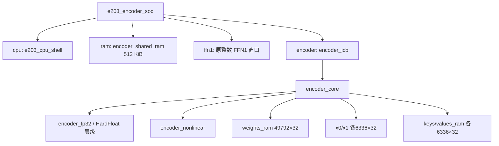

# 编码器加速器综合与性能分析

当前证据支持完整编码器与 E203 SoC 的 generic 结构综合，以及真实 CPU 完整十二层双策略的周期和逻辑访问量对照。它尚不能证明 150 MHz、2.25 mm²、平均功耗或单任务能耗：指定库映射、SRAM 宏、SDC、综合后功能检查和活动映射仍须补齐。把这些边界分开，才能避免以结构 PASS 代替正式性能验收。

## 1. 任务 7 的评测对象与统一配置

### 1.1 赛题要求的不是一个孤立 MAC 峰值

任务 7 要求完成加速器及 SoC 逻辑综合、综合前后功能检查和 150 MHz 时序检查，并报告关键路径、裕量、面积、运行周期、吞吐量、平均功耗、单任务能耗、SRAM 访问量和参数加载开销。条款位于 PDF 物理页 10／印刷页 9；计时与功耗范围位于物理页 12—13／印刷页 11—12，可核对[赛题 PDF 工程副本](../../../work/report_cycle_sources/2026赛题指南.pdf)和[赛题逐页文本](../../../work/report_cycle_sources/guide-text.txt)。设计范围是 RTL、仿真、SoC 集成及逻辑综合，不包含布局布线、物理验证与流片。

研究生任务的一次硬件任务是完整十二层编码器并写回结果，输入和最终输出均 99×64；统一软件分类头不计硬件吞吐。正式冻结后由组委会抽取覆盖十二类别的 12 个任务，从输入和参数开始装载计时，任务前清空数据与参数缓存。预处理、一次性文件格式转换、分类头与任务间 TB 复位时间排除；供参、总线等待和 E203 调度不能排除。

| 固定项 | 本地实现与正式约束 |
|---|---|
| 模型／张量 | 指定 KWT-1，12 层、M＝99、D＝64、H＝256、单头、PostNorm |
| 数据格式 | 编码器 FP32；独立 C 参考逐操作舍入、固定 FMA 顺序；冻结非线性近似 |
| 共享 SRAM | 512 KiB＝524,288 B；逐层供参，不要求全模型权重同时驻留 |
| 内部 SRAM | 正式需以指定 16 bit×128、×1024、×4096 的 SP／DP 宏组合实现 |
| 接入方式 | 真实 E203 System Bus／ICB；原 FFN1 与新增 encoder 两窗口 |
| 统一时序目标 | 150 MHz，周期约 6.666667 ns；当前未做指定库 STA 验收 |
| 新增面积预算 | ≤2.25 mm²；包含新增加速器、接口逻辑及内部 SRAM 宏 |
| 共同配置 | 同一冻结 RTL、数值规则、综合网表、库／角／负载／活动条件；不能拼接最优值 |

当前批准的优化变量只有“CPU 外部回读重装／加速器内部双缓冲交换”，目标分别减少端到端周期和共享事务，约束为同输入、同模型、同格式、全部输出逐位一致。放行见[MASTER_RELEASE](../../../work/MASTER_RELEASE_encoder_reuse.md)；本篇没有扩展到新优化或正式搜索。

### 1.2 输入怎样流向被测输出

文字流程：首层 99×64 输入与当前层 49,792 word 参数 → 共享 SRAM → E203 搬运与 ICB 命令 → encoder_core 完整 PostNorm 层 → SWAP／RELOAD → 十二层最终 6,336 word → E203 共享写回 → 计时与事务归档 → 同格式参考比较 → 以同一冻结配置进入后续工艺评测。

| 被测张量／模块 | 容量或功能 | 对性能的影响 |
|---|---|---|
| X0/X1 | 各 99×64 FP32 | 内部银行交换消除十一轮中间共享区往返 |
| weights RAM | 49,792×32 bit／层 | 十二次参数装载，共 597,504 word |
| K、V RAM | 各 99×64 FP32 | 全层生成后供各 query 复用 |
| score、prob、hidden 等 | 行级暂存 | 避免常驻完整分数矩阵，但仍有状态与访问代价 |
| 单 FP32 运算单元 | 共享 FMA、加减、乘、除、开方 | 串行多周期计算，不能用峰值 MAC 推断任务吞吐 |
| 非线性状态机 | exp、GELU | 使用同一 FP32 单元，近似与周期都受冻结顺序限制 |
| encoder_icb／CPU／共享 RAM | 搬运、调度、响应等待、结果写回 | 正式整机计时和功耗不可遗漏 |

## 2. Generic 综合实际检查了什么

### 2.1 综合流程与真实层级

当前使用 Yosys 0.33，将 SystemVerilog 控制与运算层级降低为 generic 电路表示，执行层级检查、过程转换、优化、同步存储收集和结构 `check -assert`。两条入口为[编码器综合脚本](../../../dv/encoder/run_synth.py)与[SoC 综合脚本](../../../dv/encoder/run_soc_synth.py)。流程的主体是：

```text
read_verilog → hierarchy -check → proc → opt
→ memory_dff → memory_collect → opt_clean → check -assert
→ stat → write_json design.json
```

`write_json` 生成可机读的 generic 网络，不是指定工艺库映射后的门级网表。没有 Liberty／SRAM 宏映射、正式时序分析或功耗计算步骤，因此 PASS 的结论限定为结构和存储推断。



| 证据 | 已完成的实际检查 | 可以得出的结论 |
|---|---|---|
| [encoder status](../../../reports/encoder/synthesis/status.json) | top=`encoder_icb`；bulk 实例／容量检查；时钟读 RAM 检查 | 完整编码器 generic 层级与 bulk 推断 PASS |
| [SoC status](../../../reports/encoder/synthesis/soc/status.json) | top=`e203_encoder_soc`；cpu/ram/encoder/ffn1 实例存在且类型可解析 | 完整公共 E203 与两加速器窗口进入 generic 网络 |
| [独立综合回读](../../../reports/system/root-encoder-synth-readback.json) | 回读 170 份综合来源、design 哈希；278 个从顶层可达模块；共享 RAM 几何 | 不是空壳 top，也不是遗漏 CPU 或 RAM 后得到的结构结果 |

SoC design 文件共有 279 个模块定义，独立回读确认顶层可达 278 个；二者分别是“文件定义数”和“从顶层可达数”，不矛盾。顶层实际连接的 `cpu` 为 `e203_cpu_shell`、`ram` 为 `encoder_shared_ram`，`encoder` 和 `ffn1` 为各自参数化 ICB 模块。实例关系可直接核对 [SoC RTL](../../../soc/e203_encoder/e203_encoder_soc.sv)与 [SoC design.json](../../../reports/encoder/synthesis/soc/design.json)。

两窗口保留原 FFN1 `0x11000000`，新增 encoder `0x11010000`；顶层以 `pending` 保存当前响应来自哪个从设备，防止未消费响应被下一命令覆盖。CPU 在固件中实际读取原 FFN1 ID，再进入编码器流程，连接存在与软件路径有相互印证。

### 2.2 RAM 推断与容量不能当成宏面积

`encoder_sync_ram` 在时钟沿写入并读取，RAM 数组没有整体 reset；装载计数和控制状态决定数据是否有效。这样能使大数组保留为同步存储，而不是因清零过程被分散为大量复位触发器。当前 encoder generic 综合检查到如下 bulk 实例：

| 实例 | 深度×宽度 | 容量 | 复用方式 |
|---|---:|---:|---|
| weights_ram | 49,792×32 | 199,168 B | 当前层参数，下一层覆盖 |
| x0 | 6,336×32 | 25,344 B | X/Y 银行之一 |
| x1 | 6,336×32 | 25,344 B | X/Y 银行之二 |
| keys | 6,336×32 | 25,344 B | 全序列 K |
| values_ram | 6,336×32 | 25,344 B | 全序列 V |
| bulk 合计 | 75,136×32 | **300,544 B** | 不含行暂存、控制与 FP32 状态 |

行级 `q/context_row/tmp/n1` 各 64 word、`score/prob` 各 99 word、`hidden` 256 word，共 710 word／2,840 B；非线性常数 ROM 等另计。generic 中小数组的实现可能是推断存储、寄存器或组合选择网络，不能把逻辑字节和最终 SRAM 宏字节一概相加后宣布面积。

共享 RAM 另外是 131,072×32 bit＝4,194,304 bit＝524,288 B，位于 `[0xA0000000,0xA0080000)`。它与内部 300,544 B bulk 是不同存储对象，不能把后者塞入共享容量，也不能遗漏其新增面积。当前共享布局为输入 `0xA0001000`、当前层参数 `0xA0008000`、输出 `0xA0040000`，详见[参数调度报告](06_十二层编码器与参数调度.md)。

正式宏映射必须把 32 位数据的位宽和非标准深度拆分到指定 16 位宏，选择 SP／DP、处理读延迟、端口冲突、写掩码、银行选择与容量填充，并验证其行为等价。当前 1R1W 推断并不自动对应某一指定宏；不能假定两个 16 位宏并联后，所有端口和时序问题都已解决。本轮没有进行该映射或新增宏方案优化。

### 2.3 面积、功耗为什么采用不同统计边界

正式新增面积应为：

$$
A_{\rm budget}=A_{\rm new\ accelerator}+A_{\rm new\ interface}
+\sum_m n_m A_{\rm internal\ SRAM,m}\le2.25\ \mathrm{mm}^2.
$$

新增加速器逻辑、接口与内部 SRAM 宏必须全部计入，包含提交配置中保留的新增硬件，不能凭功能暂时未使用就从预算删除。复用的 E203、512 KiB 共享 SRAM、固定总线和外设不计入该预算，但面积仍需单列；不得重复计数。

功耗范围则包含 E203、加速器、互连和 SRAM 的动态与静态功耗，排除模拟模块与片外设备。CPU 与共享 SRAM 即使不计新增面积，也不能从整 SoC 能耗删除。活动信息必须覆盖同一计时窗口，检查 SAIF／VCD 到映射网表的层级匹配与覆盖率，未标注电路不能按零活动，未建模 SRAM 不能按零功耗。

## 3. 真实性能计时：首 MMIO 到末输出写拍

### 3.1 精确定义观察边界

[系统测试台](../../../dv/e203_encoder/tb_e203_encoder.sv)在外设 ICB 命令被接受时捕获 `first_cycle`，在输出区最后一个 word 以完整掩码被接受并写入共享 RAM 时捕获 `last_cycle`。因此：

$$
C_{\rm E2E}=C_{\rm final\ write}-C_{\rm first\ MMIO}+1.
$$

加一表示首末两个拍均包含。结束点是共享写真实生效的拍，后续响应消费、BOOT 终止标记和模拟器退出不属于该窗口。两策略首拍都是 4,543，pingpong 末拍为 284,358,022，reload 末拍为 290,631,971，得到 284,353,480／290,627,429 周期。status 中总仿真 `cycles=284358108/290632057` 是另一边界，不能直接当任务周期。

复位前 TB 通过公开共享 RAM 预置输入 fixture，这部分不消耗计时周期；窗内计入 CPU 将 6,336 word 搬入加速器、host 逐层一 word／周期供参、CPU 将参数写入 encoder、计算等待、换层和最终写回。故本文称其为**本地观察窗口的端到端周期**，不能称“已经满足正式输入开始装载边界”。正式平台仍需从输入与参数首次装载开始，保证任务缓存清空。

固件每层 `rdcycle` 从参数 ready 后、调用 `encoder_layer_mode()` 前开始；它不含该层 host 提供参数的全部前置过程。不能将十二个固件差值之和替换测试台端到端周期。

### 3.2 四段不重叠周期与求和

[performance.json](../../../reports/encoder/verification/performance.json)按实际 host／START 日志拆分边界，独立回读同时核对了顺序、差值和求和：

| 不重叠区段 | pingpong | reload | 含义 |
|---|---:|---:|---|
| 首 MMIO→首 host 请求 | 285,547 | 285,547 | 含 CPU 初始化与首层输入搬运 |
| 十二层 host 供参 | 597,504 | 597,504 | 12×49,792，每 word 一个周期 |
| 参数 ready→START | 28,685,484 | 28,685,484 | 每层 2,390,457；含 CPU 装参与控制 |
| START→下一请求／最终写回 | 254,784,945 | 261,058,894 | 神经计算、响应等待、读回／重装与层间控制 |
| **合计** | **284,353,480** | **290,627,429** | 与 inclusive 端点公式一致 |

最后一段不是纯 core compute，不能将其直接标为“乘加耗时”。host 供参 597,504 周期也不是全部参数加载成本；CPU 后续从共享 RAM 读取并写入 encoder 的成本包含在 ready→START 段。复用只改变 START 后的层间交接，两策略前三段相同、末层都最终读回。

### 3.3 逐层对照定位收益

| 层号 | 参数 ready→START，两者相同 | pingpong START 后区段 | reload START 后区段 | 差值 |
|---:|---:|---:|---:|---:|
| 0 | 2,390,457 | 21,210,719 | 21,781,078 | 570,359 |
| 1 | 2,390,457 | 21,203,717 | 21,774,076 | 570,359 |
| 2 | 2,390,457 | 21,206,227 | 21,776,586 | 570,359 |
| 3 | 2,390,457 | 21,210,228 | 21,780,587 | 570,359 |
| 4 | 2,390,457 | 21,211,228 | 21,781,587 | 570,359 |
| 5 | 2,390,457 | 21,207,489 | 21,777,848 | 570,359 |
| 6 | 2,390,457 | 21,210,845 | 21,781,204 | 570,359 |
| 7 | 2,390,457 | 21,212,204 | 21,782,563 | 570,359 |
| 8 | 2,390,457 | 21,211,511 | 21,781,870 | 570,359 |
| 9 | 2,390,457 | 21,206,934 | 21,777,293 | 570,359 |
| 10 | 2,390,457 | 21,204,770 | 21,775,129 | 570,359 |
| 11 | 2,390,457 | 21,489,073 | 21,489,073 | 0 |

每层另有相同的 host 49,792 周期。前十一层各减少 570,359 周期，合计 `11×570359=6273949`；最后一层没有下一层重装，因此不产生这一收益。不同层 compute 有少量差异，与数据相关的多周期运算路径有关，不能把某一层的周期复制到全部层。

## 4. 实际事务、吞吐与能耗口径

### 4.1 CPU 与供参 host 必须分列

| 观测值 | pingpong | reload | 绝对减少 | 相对 reload 减少 |
|---|---:|---:|---:|---:|
| CPU 共享读 | 653,640 | 723,336 | 69,696 | 9.6353562% |
| CPU 共享写 | 6,394 | 76,090 | 69,696 | 91.5967933% |
| CPU 共享合计 | 660,034 | 799,426 | 139,392 | 17.4365107% |
| CPU word 事务折算字节 | 2,640,136 | 3,197,704 | 557,568 | 17.4365107% |
| host 参数写 | 597,504 | 597,504 | 0 | 0% |
| host ready 写 | 12 | 12 | 0 | 0% |
| host 请求层号读 | 12 | 12 | 0 | 0% |
| CPU＋供参 host 逻辑合计 | 1,257,562 | 1,396,954 | 139,392 | 9.9782813% |
| 逻辑合计 word 字节 | 5,030,248 | 5,587,816 | 557,568 | 9.9782813% |
| 端到端周期 | 284,353,480 | 290,627,429 | 6,273,949 | 2.1587601% |

CPU 共享量来自真实 `sysmem` 命令 valid/ready 握手，截止最终输出写入。host 在本地供参模型中直接访问公开共享数组，所以其参数写／ready 写／请求读作为独立逻辑访问列出，不能称为同一个 ICB 物理端口的观测量。逻辑合计包括两类事件，不含复位前输入 fixture、加速器内部 RAM、旁路核验探针，也不是物理宏能量或逐 byte 掩码活动计数。

内部交换省去十一轮 CPU 中间输出写回及重新读入：每种方向 `11×6336=69696` 个共享事务。参数流量不变，每策略都需 host 597,504 word 参数供应，再由 CPU 完成 597,504 次 encoder WEIGHT 写。不能把一次逻辑搬运两端的计数混成“唯一数据字节”，也不能漏掉 host 以放大收益。

原始 status 还有 `instructions=16716244/20271323`、`bus_waits=0/0`。前者按 `ifu_o_valid&&ifu_o_ready` 统计，是 IFU 向执行级交付握手，**不是退休指令计数**；后者只统计 `sysper_icb_cmd_valid&&!ready`，是命令端背压，**不涵盖 WAIT_DONE 的响应等待**。两者只能按这些定义引用。

### 4.2 周期可以换算，时序合格还不能推定

对完成 N 个任务、计时周期合计 C、实际工作频率 f，定义：

$$
t=C/f,\qquad \mathrm{Throughput}=Nf/C,\qquad
E_{\rm task}=P_{\rm avg}\frac{C}{fN}.
$$

这里 $P_{\rm avg}$ 必须是同网表、同条件、同窗口的整 SoC 平均功耗，不能由事务数乘一个未知常数代替。当前尚无正式功耗值，所以不能给出焦耳／任务或节能百分比。

仅作单位换算，若实现能够在 150 MHz 工作，则本地同一窗口的 pingpong 284,353,480 周期对应 1.895689867 s、0.527512447 任务／秒；reload 对应 1.937516193 s、0.516124719 任务／秒。它们是**假定频率下的本地窗口换算**，不作为已通过 STA 的吞吐量，更不作为官方十二任务的成绩。测试台的 `#2` 时钟延迟只是仿真激励，不能证明芯片可以按该频率运行。

周期减少比例与吞吐提升比例分母不同。本文报告 `6273949/290627429=2.1587601%` 的周期减少；若讨论吞吐提升，应使用 `290627429/284353480-1`，不能直接把周期减少百分比改名为吞吐提升。

## 5. 功能、误差、冻结来源与独立证据

### 5.1 性能比较成立前先确认没有改算术

两策略都执行同一 `eight_750e3e75_nohash_0` 输入的完整十二层，76,032 个被动 neural word 全部逐位等于独立 C 参考。policy1 CPU 写回最后层 6,336 word，policy2 写回十二层 76,032 word；两者有限值与位差均为零。核验由[独立 CPU 回读](../../../reports/system/review/encoder-final-cpu-readback.md)完成，不把“跳过中间 CPU 回读”理解成“跳过中间计算”。

| 证据层 | 当前实际覆盖 | 能证明什么／不能证明什么 |
|---|---|---|
| RTL 全层工程案例 | 15 输入、180 层、1,140,480 word | 当前源实现完整数值链；不等于十二次整机性能测试 |
| 独立 CPU 双策略 | 同输入各一次十二层；152,064 neural word＋82,368 CPU word 比较 | 两交接策略本例位真等价、真实搬运和计时可核对 |
| 原三输入参考 | 36 层，最大最终 NRMSE 0.0004071640493761876 | 本设计对官方数值误差摘要 |
| test 十二类工程子集 | 144 层，最大最终 NRMSE 0.000513838042935309；预测一致 12／12 | 工程覆盖；不能推断官方 600 样本准确率 |
| 固定非线性验证 | exp 100,001 点、GELU 40,001 点 | 固定近似公式检查，未做参数搜索 |
| generic 结构综合 | encoder 与含真实 E203 的 SoC 层级 | 可综合结构；不能证明工艺映射、时序、面积与功耗 |

上述 15 个 RTL 案例的 core busy 周期总和为 3,817,428,084，只能作为[逐例 CSV](../../../reports/encoder/verification/rtl-case-results.csv)的计算覆盖摘要；不是 15 个 CPU 端到端任务的时间。逐层记录见[180 行 CSV](../../../reports/encoder/verification/rtl-layer-results.csv)。

test 子集的 silence 样本真实标签为 silence，但本设计与官方均预测 unknown；12／12 是预测一致，不能说十二标签都正确。正式研究生精度门为同一 600 样本和同一分类头的 Top-1 相对下降≤2 个百分点，仍待统一评测。当前使用固定数值配置，不能据 test 子集调参。分类头与误差机制见[十二层报告](06_十二层编码器与参数调度.md)和[参考 manifest](../../../reports/encoder/reference-test12/manifest.json)。

### 5.2 版本绑定的最小证据链

[冻结源清单](../../../work/encoder_source_freeze.json)包含 192 项，其 SHA-256 为 `4c11f4fa9c83592ee0e622e9c6a6ccf52a21eacef8d4a898e44aaf57cd27cc17`。冻结工具版本包括 Verilator 5.020、Icarus 12.0、RISC-V GCC 13.2.0、Yosys 0.33、Python 3.12.3。报告机器上的 Python 版本不替换这些原运行版本。

| 产物 | 绑定身份／摘要 |
|---|---|
| pingpong status | SHA `a7f02731525f35de51b14b704f68034f71068a61baa0a37d39da39385e1890ef`；run_id `d18f738a74a7484ea373579705c2adef` |
| reload status | SHA `774e2f0b5079dd024c5f1f717612e42de39a1781bae48b9f9816d2d626bd61df`；run_id `33b068f04ba448339d21251dec76f2c3` |
| 两策略实际模拟器 binary | SHA `f3757e5e36e51fd8c67140ed2992f6b2074fae48a8699113880a6435ea071bf9` |
| 两策略 neural 全层输出 | SHA `ae7f60afa77bd974c7f82c3b3333cc9c746768cea90efc71eb53725c48198fea` |
| encoder generic design.json | SHA `dd33ad7cf25e0b9fba87142f5bb90cbff6e38b3d7eeca470bf64cb4ddb27d1eb` |
| SoC generic design.json | SHA `a9121f08237e4b110c3f2b917d78b7658514a911904b6c684d61bfbbde6cdce6` |

原始 CPU status 分别记录 178 项自身来源、172 项编译来源和 30 项输入绑定；独立回读还核对已绑定 ELF 派生的 bin／hex、BYTES、命令与产物 SHA。来源表数量不同来自各自范围，不应强行改成相同。完整入口见[pingpong status](../../../reports/encoder/system/pingpong/status.json)、[reload status](../../../reports/encoder/system/reload/status.json)、[性能 JSON](../../../reports/encoder/verification/performance.json)和[独立回读证据 manifest](../../../reports/system/review/encoder-final-cpu-readback/manifest.json)。

这些摘要绑定已有证据，不代替项目整体接受。统一本地入口 run_id `84ef1f97e1394486b11b5510f79716d4` 已实际退出 0、PASS 且 gate 为 7／7；持久 CLI 的最终回读退出、两轮独立报告审查和总控接受另行记录。整体接受以总体验收及根控记录为准，不能因某一综合 status 为 PASS 就提前宣称正式赛题通过。

## 6. 复现顺序、成功标记与正式待验项

### 6.1 可复查的命令与结果位置

先在 WSL 项目根目录使用只读核对：

```bash
.venv-dv/bin/python dv/encoder/freeze_sources.py --verify
```

成功为退出 0 和 `ENCODER_SOURCE_FREEZE_CURRENT files=192`。现有 CPU 完整日志位于[pingpong simulation.log](../../../reports/encoder/system/pingpong/simulation.log)和[reload simulation.log](../../../reports/encoder/system/reload/simulation.log)，实际命令位于各自 `commands.jsonl`；证据可直接回读，无须为报告反复运行长仿真。

需要重建时，在现有统一验收结束后串行执行；以下会写对应综合目录，本轮作者没有运行：

```bash
.venv-dv/bin/python dv/encoder/run_synth.py
.venv-dv/bin/python dv/encoder/run_soc_synth.py
```

分别要求 `ENCODER_GENERIC_SYNTH_PASS`／`ENCODER_SOC_GENERIC_SYNTH_PASS`，退出 0，status＝PASS，design／log SHA 匹配，五个 bulk 实例与 SoC 四个顶层连接仍存在。`hierarchy` 缺失、`check -assert` 失败、bulk 几何或同步读错误、来源运行中变化都应判失败。两条入口不自动产生工艺映射网表、SDC、门级仿真或功耗报告。

真实 CPU 重建入口为：

```bash
bash scripts/run_e203_encoder.sh --case eight_750e3e75_nohash_0 --policy 1 --output reports/encoder/system/reproduce-pingpong
bash scripts/run_e203_encoder.sh --case eight_750e3e75_nohash_0 --policy 2 --output reports/encoder/system/reproduce-reload
```

完整成功条件为十二次 START、十二次 host 请求、597,504 word 参数、76,032 neural word、对应策略 CPU 输出数、零位差、有限结果及来源／产物 SHA 一致。`E203_ENCODER_PASS` 只有与这些检查共同成立才有效；编译成功、旧进度文件或目录存在不能证明一次新运行已经完成。复现脚本会构建真实固件和 Verilator binary，需使用原记录工具条件，不由 Windows 的通用 Python 替代 WSL 工具链。

### 6.2 正式任务 7 的缺口与交付条件

| 正式要求 | 当前状态 | 进入可验收状态所需证据 |
|---|---|---|
| 指定工艺映射与 SRAM 宏 | EXTERNAL_PENDING | 指定库、SP／DP 宏模型、组合方案、端口／延迟等价检查与宏面积 |
| SDC 和 150 MHz 时序 | EXTERNAL_PENDING | 6.666667 ns 目标、合法 clock／I/O／负载约束、关键路径、裕量与时序检查；不隐藏违例 |
| 映射后综合网表 | EXTERNAL_PENDING | 与冻结 RTL／数值配置绑定的技术网表与校验值；generic JSON 不能替代 |
| 综合前后功能一致 | EXTERNAL_PENDING | 对同一正式网表进行功能对照，必要模型完整；当前仅有 RTL 位真与结构综合 |
| 面积≤2.25 mm² | EXTERNAL_PENDING | 新增逻辑＋接口＋内部宏，指定库结果；CPU／共享／固定单列 |
| SAIF／VCD 映射与覆盖 | EXTERNAL_PENDING | 同计时窗口的活动、层级映射、标注覆盖与未标注处理、SRAM 功耗模型 |
| 平均功耗／单任务能耗 | EXTERNAL_PENDING | 同网表、库角、负载、时钟与互连估计；整 SoC 统计范围及 J／任务计算 |
| 官方十二个性能任务 | EXTERNAL_PENDING | 统一抽取输入、清缓存、从输入与参数装载开始的完整窗口及输出写回 |
| 官方 600 样本分类精度 | EXTERNAL_PENDING | 同评测集、同软件分类头，Top-1 下降门槛与全部解码有限值 |

上述工作在逻辑综合阶段完成即可；无需新增布局布线验收。本地周期对照有可复核价值，但不能替代这张表中的外部条件，也不据缺失条件编造关键路径、面积或功耗值。

## 7. 具体自检与答案

1. **为何 279 个模块定义与 278 个可达模块能同时正确？** 答：前者统计 JSON 中所有定义，后者只统计从 top 沿实例关系可到达的模块。判断 SoC 完整性应检查 cpu／ram／encoder／ffn1 真实连接，不只比较一个总数。
2. **用四段重算 pingpong 周期。** 答：`285547+597504+28685484+254784945=284353480`；再核对 `284358022−4543+1` 得同值。少加 1 会遗漏首末拍的 inclusive 口径。
3. **为何 host 已加载 597,504 周期，参数开销还不能只写这一个数？** 答：这只覆盖 host 向共享参数区逐 word 提供参数；CPU 之后还需 load/store 到 encoder，发生在 28,685,484 周期的 ready→START 区段内，且该段还含控制开销。
4. **CPU 事务减少比例为何是 17.4365107%，合计却是 9.9782813%？** 答：分子均为 139,392；CPU 分母 799,426，含 host 的分母为 `799426+597504+12+12=1396954`，后者更大。不能混用分母。
5. **若拿到平均功耗 0.1 W，能立即写本项目每任务能耗吗？** 答：不能。必须先核对该功耗是否来自同一冻结网表、正式频率和完整计时窗口，是否含 CPU／互连／全部 SRAM，以及活动映射是否合格；满足后才用 $P_{\rm avg}C/(fN)$。
6. **看到 generic RAM 有 300,544 B 能否推导面积合格？** 答：不能。还需要指定宏的深度／端口组合、填充与译码、宏面积和标准单元面积；容量不是 mm²。
7. **当前最稳妥的性能结论是什么？** 答：同一冻结实现、同一真实输入各跑完整十二层且位真一致时，内部交换比外部重载少 6,273,949 个本地端到端周期、139,392 个 CPU 共享事务；正式频率、PPA 和官方评测仍待验。

